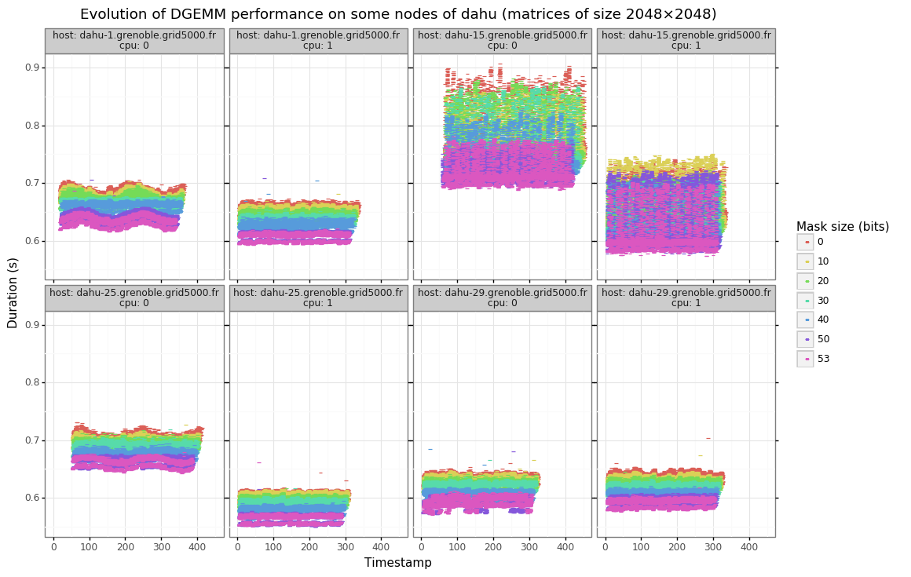
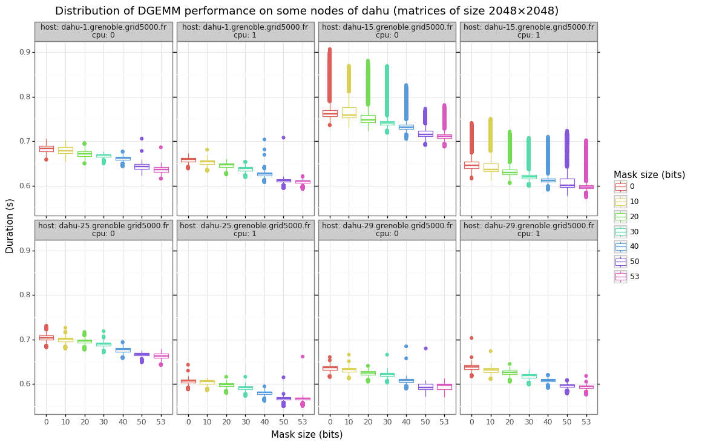
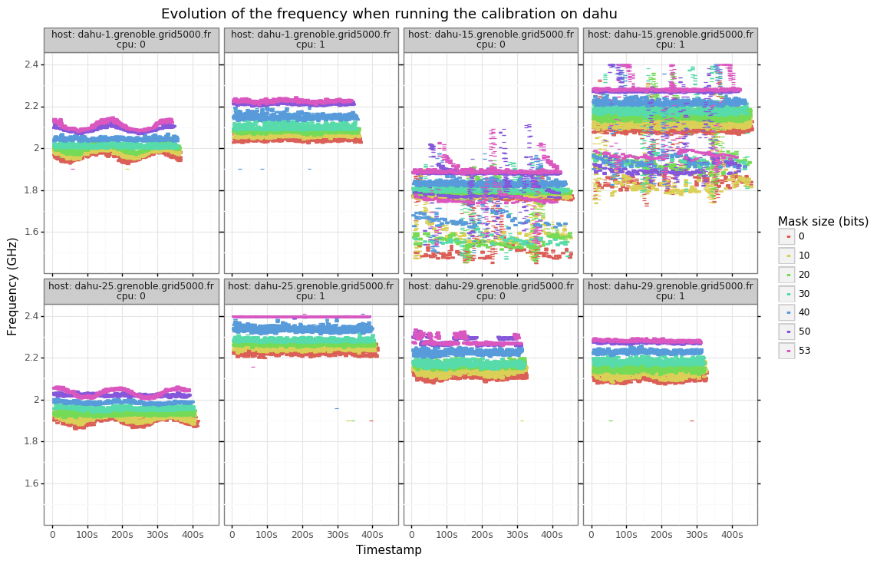
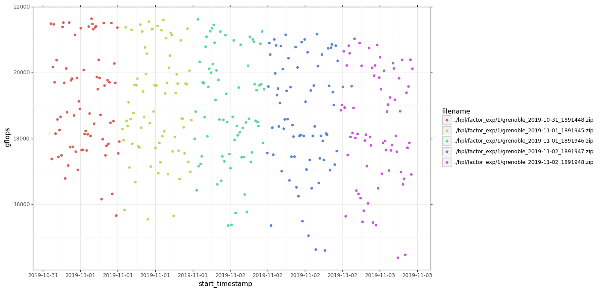
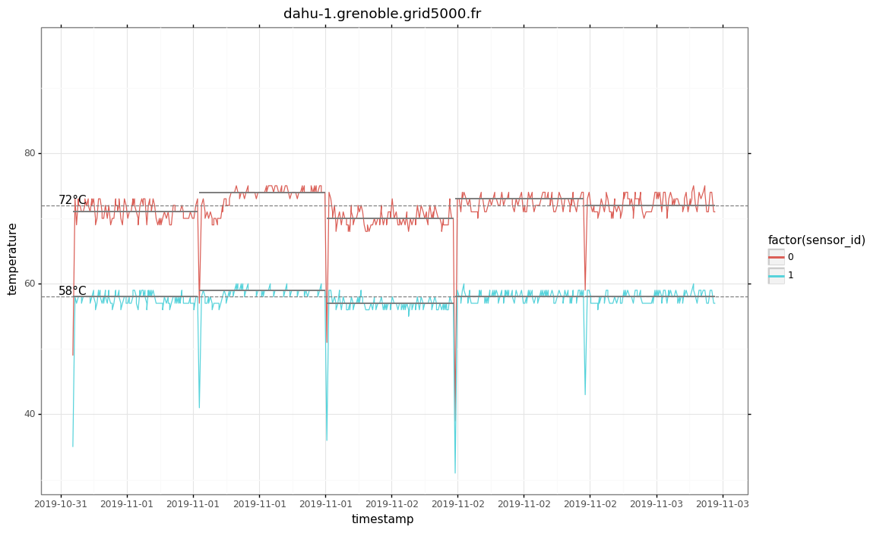
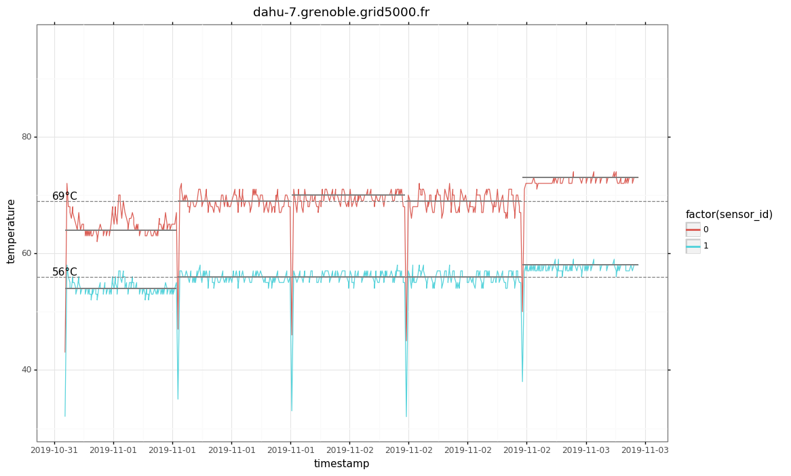

# -*- coding: utf-8 -*-
# -*- mode: org -*-
#+startup: beamer overview indent
#+LANGUAGE: pt-br
#+TAGS: noexport(n)
#+EXPORT_EXCLUDE_TAGS: noexport
#+EXPORT_SELECT_TAGS: export

#+Title: Análise de Desempenho de Sist. Comp.
#+SubTitle: SimGrid II: calibração e validação; estudo de caso HPL
#+Author: Prof. Lucas Mello Schnorr
#+Date: \copyleft

#+LaTeX_CLASS: beamer
#+LaTeX_CLASS_OPTIONS: [xcolor=dvipsnames,10pt]
#+OPTIONS: H:1 num:t toc:nil \n:nil @:t ::t |:t ^:t -:t f:t *:t <:t
#+LATEX_HEADER: \input{org-babel.tex}

* Onde paramos

- Aula 27: SimGrid, modelos de fluxo (CPU, rede max-min), S4U,
  mestre--trabalhadores
  - plataforma descrita com números "redondos": 1 Gflop/s, 125 MB/s, 50
    \(\mu\)s
#+latex: \pause
- Pergunta incômoda: *de onde vêm esses números?*
  - o simulador é tão bom quanto seus parâmetros
  - valores nominais (pico teórico, banda do fabricante) raramente são os
    efetivos

#+latex: \vfill\pause

** Hoje                                                            :B_block:
:PROPERTIES:
:BEAMER_env: block
:END:
1. O problema da *calibração* (e por que ela não é validação)
2. *SMPI*: executar código MPI real sobre o simulador
3. Exemplo real: calibrar latência e banda de um ping-pong por *regressão
   linear*, injetar no SMPI e validar
4. Estudo de caso *HPL* (Cornebize, Legrand et al.): o =dgemm= modelado
   por regressão, variabilidade espacial/temporal

* O problema da calibração

Calibrar = estimar os parâmetros do modelo a partir de *medições* no
sistema real.

#+ATTR_LATEX: :font \small
| Parâmetro do modelo           | Como medir (microbenchmark)                  |
|-------------------------------+----------------------------------------------|
| velocidade do host (flop/s)   | executar o kernel de interesse e cronometrar |
| custo de um kernel (=dgemm=)  | tempo vs. dimensões \(\rightarrow\) regressão |
| latência e banda efetivas     | ping-pong com vários tamanhos de mensagem    |
| sobrecustos do MPI            | tempo de =MPI_Send= / =MPI_Recv= isolados    |
| variabilidade                 | réplicas, vários nós, vários momentos        |

#+latex: \vfill\pause

- Cada linha é um *experimento*: tudo das aulas anteriores vale
  - planejamento, randomização, réplicas, verificação de hipóteses
  - ajuste de modelos (regressão), diagnóstico dos resíduos
#+latex: \pause
- Calibrar não é "achar o número que faz a simulação bater"
  - isso é *sobreajuste*: o modelo acerta o caso de calibração e erra
    todos os outros

* Calibração \neq{} validação

#+latex: \begin{columns}\begin{column}{.49\linewidth}
#+latex: \begin{block}{Calibração}
- microbenchmarks *simples*
- isolam um fenômeno por vez
- produzem parâmetros
  (\(L\), \(B\), \(\alpha\), ...)
#+latex: \end{block}
#+latex: \end{column}\begin{column}{.49\linewidth}
#+latex: \begin{block}{Validação}
- a *aplicação* (ou cenários) de interesse
- condições *diferentes* das de calibração
- compara predição vs. medição, com incerteza
#+latex: \end{block}
#+latex: \end{column}\end{columns}

#+latex: \vfill\pause

Metodologia (resumo)
1. Escolher o modelo (fórmula) para cada recurso/kernel
2. Planejar e executar microbenchmarks *randomizados*, com réplicas
3. Ajustar o modelo (regressão), diagnosticar resíduos
4. Injetar os parâmetros no simulador; *verificar* que ele reproduz o
   modelo
5. *Validar* em cenários não usados na calibração; reportar o erro

#+latex: \vfill\pause

\centering Se a validação falhar: o modelo (ou a calibração) é que muda,
não os dados.

* SMPI: MPI real sobre o simulador

- SMPI = implementação de MPI *dentro* do SimGrid (Degomme et al., IEEE
  TPDS 2017)
  - compila uma aplicação MPI (C/C++/Fortran) *sem modificá-la*
  - todos os ranks rodam como atores de *um único processo* do SO
#+latex: \pause
- Simulação *on-line*
  - o código da aplicação *executa de verdade* entre as chamadas MPI
  - cada trecho de computação é *cronometrado* e injetado como uma
    atividade =Exec= no host simulado (escalado por =smpi/host-speed=)
  - cada chamada MPI vira comunicações simuladas (modelo de rede)
#+latex: \pause
- Fiel ao MPI real
  - protocolos /eager/ vs. /rendezvous/, modos de envio
  - coletivas implementadas com os *mesmos algoritmos* de Open MPI e
    MPICH (selecionáveis)
- Também: /replay/ off-line de rastros independentes de tempo
  (=-trace-ti=, =-replay=)

* Usando o SMPI

#+begin_src sh :exports code
smpicc -O2 pingpong.c -o pingpong       # mpicc -> smpicc
smpirun -np 2 -platform platform-2hosts.xml -hostfile hostfile.txt \
        --cfg=smpi/simulate-computation:no \
        ./pingpong sizes.txt
#+end_src

#+begin_src xml :exports code
<zone id="z" routing="Full">
  <host id="h0" speed="1Gf"/>  <host id="h1" speed="1Gf"/>
  <link id="l" bandwidth="10GBps" latency="10us"/>
  <route src="h0" dst="h1"><link_ctn id="l"/></route>
</zone>
#+end_src

#+latex: \vfill\pause

- =hostfile=: em que host simulado cada rank roda
- =MPI_Wtime()= devolve o *tempo simulado*
- =simulate-computation:no=: ignora o tempo de CPU real entre chamadas
  (útil quando só a rede interessa)

* Emulação vs. simulação no SMPI

Executar todo o código tem um custo: simular 1000 ranks que computam
\(\Rightarrow\) executar a computação de 1000 ranks em *um* núcleo.

#+latex: \vfill\pause

- *Emulação* (padrão): o código roda e é cronometrado
  - fiel, mas o custo de simular \(\approx\) soma do custo de computação
    de todos os ranks
  - memória: \(P\) ranks \(\times\) seus dados
#+latex: \pause
- *Simulação* dos kernels: trocar a execução por um *modelo de custo*
  - =smpi_execute(duracao)=, =smpi_execute_flops(f)=: avança o relógio
    sem calcular nada
  - =SMPI_SAMPLE_LOCAL/GLOBAL=: executa algumas iterações, mede e
    extrapola as demais
  - =SMPI_SHARED_MALLOC=: todos os ranks compartilham o mesmo buffer
    (/memory folding/) \(\rightarrow\) os resultados numéricos ficam
    errados, mas o *tempo* não
#+latex: \pause

\centering Precisamos de *modelos de custo* para os kernels: regressão!

* O modelo de rede do SMPI

- Tempo de uma mensagem de \(s\) bytes num link (\(L\), \(B\)):
  \[ T(s) = \lambda(s)\,L + \frac{s}{\beta(s)\,B} \]
  com fatores \(\lambda(s)\), \(\beta(s)\) *constantes por partes* em \(s\)
#+latex: \pause
- Por quê? O MPI muda de comportamento conforme o tamanho
  - mensagens pequenas: /eager/ (copiadas para buffers internos)
  - grandes: /rendezvous/ (aperto de mão + cópia direta)
  - cada faixa tem sua latência e banda efetivas
#+latex: \pause
- Configuração (formato =limiar:fator;limiar:fator=):
#+begin_src sh :exports code
--cfg=smpi/lat-factor:"0:0.0307;4096:0.154"
--cfg=smpi/bw-factor:"0:0.493;4096:1.70"
#+end_src

#+latex: \vfill\pause

- Os padrões do SimGrid vêm de calibrações em clusters reais; para *sua*
  máquina, calibre: \(T(s) = L + s/B\) é uma *regressão linear* em \(s\)
  (intercepto \(= L\), inclinação \(= 1/B\))

* Exemplo real: ping-pong, plano experimental

- Programa: =a28_smpi/pingpong.c= (rank 0 envia \(s\) bytes, rank 1
  devolve; tempo de ida = ida-e-volta / 2)
- Sistema "real": Open MPI, 2 processos no mesmo notebook (i7-13800H),
  memória compartilhada, =--bind-to core=

#+latex: \vfill\pause

| Conjunto   | Tamanhos                                           | Medidas |
|------------+----------------------------------------------------+---------|
| calibração | 400 sorteados log-uniformes em [1 B, 4 MiB]        |     400 |
| validação  | 45 tamanhos (\(2^k\) e \(1{,}5 \cdot 2^k\)) \(\times\) 10 réplicas |     450 |

- *Ordem aleatória* das medidas (=gen-sizes.R=, semente fixa): evita
  confundir tamanho com tempo (aquecimento, deriva)
- Validação usa tamanhos *diferentes* e uma *execução separada*

#+latex: \vfill\pause

- Tudo em =a28_smpi/run.sh=: mede o real, ajusta, simula com o SMPI
  (Docker), gera CSVs

* Os dados de calibração

#+attr_latex: :width .9\linewidth
[[file:pdf_babel/a28_pp_dados.pdf]]

\scriptsize Escalas log--log. Linha vertical: 4 KiB. Note o salto (mudança
de protocolo no Open MPI) e os valores atípicos.

* Primeira tentativa: uma reta (MQO)

Modelo da aula 23: \(T_i = L + s_i / B + \varepsilon_i\), mínimos
quadrados ordinários sobre os 400 pontos:

#+begin_src R :exports code
m1 <- lm(time ~ size, data = calib)
#+end_src

#+ATTR_LATEX: :font \small
|                  | Estimativa                        | Erro-padrão           |
|------------------+-----------------------------------+-----------------------|
| \(L\) (intercepto) | \(-0{,}48\ \mu\)s                 | \(0{,}95\ \mu\)s       |
| \(1/B\) (inclinação) | \(6{,}71 \cdot 10^{-11}\) s/B (\(B \approx 14{,}9\) GB/s) | \(1{,}3 \cdot 10^{-12}\) |

#+latex: \vfill\pause

- *Latência negativa*: fisicamente absurda (e não significativa)
- O ajuste é dominado pelas mensagens grandes:
  - em valor absoluto, o ruído das mensagens de MB é muito maior que o tempo
    inteiro das mensagens pequenas
  - *heterocedasticidade* (aula 24): variância cresce com \(s\)
- Comportamento diferente abaixo/acima de 4 KiB: *um* modelo linear não
  descreve as duas faixas

* Segunda tentativa: por partes, ponderado

Aula 25: fator categórico (faixa) + interação; heterocedasticidade
\(\rightarrow\) mínimos quadrados *ponderados* (peso \(1/T^2\) \(\approx\)
erro relativo)

#+begin_src R :exports code
pequenas <- subset(calib, size <  4096)
grandes  <- subset(calib, size >= 4096)
m2a <- lm(time ~ size, data = pequenas, weights = 1/time^2)
m2b <- lm(time ~ size, data = grandes,  weights = 1/time^2)
#+end_src

#+ATTR_LATEX: :font \small
| Faixa       | \(L\) (\(\mu\)s)       | \(B\) (GB/s) |
|-------------+------------------------+--------------|
| \(< 4\) KiB | 0,31 (e.p. 0,005)      | 4,9          |
| \(\geq 4\) KiB | 1,54 (e.p. 0,04)    | 17,0         |

#+latex: \vfill\pause

- Faz sentido físico: /eager/ = latência baixa, banda baixa (cópias
  extras); acima de 4 KiB, cópia direta: latência maior, banda maior
- O limiar (4 KiB) foi escolhido *olhando os dados*; alternativa: buscar o
  limiar que minimiza o erro (regressão segmentada)

* Os dois ajustes

#+attr_latex: :width .95\linewidth
[[file:pdf_babel/a28_pp_ajuste.pdf]]

\scriptsize Esquerda: dados e modelos (log--log; a reta única some à esquerda
porque prevê tempos *negativos*). Direita: erro relativo \((\hat{T} - T)/T\).
O modelo ponderado tem erro relativo homogêneo em todas as faixas.

* Injetando a calibração no SMPI

- Base do link: \(L_0 = 10\ \mu\)s, \(B_0 = 10\) GB/s; fatores =
  estimativa / base (=fit.R= escreve =factors.csv=)

#+begin_src sh :exports code
smpirun -np 2 -platform platform-2hosts.xml -hostfile hostfile.txt \
  --cfg=smpi/simulate-computation:no \
  --cfg=smpi/lat-factor:"0:0.030651;4096:0.153866" \
  --cfg=smpi/bw-factor:"0:0.493232;4096:1.69953" \
  --cfg=network/crosstraffic:0 --cfg=smpi/send-is-detached-thresh:0 \
  ./pingpong-smpi sizes-sim.txt
#+end_src

#+latex: \vfill\pause

- Simulação determinística: *uma* execução por tamanho basta
- Três configurações simuladas
  1. reta única (MQO) --- latência negativa
  2. por partes, ponderado, opções "limpas" (as duas últimas linhas)
  3. por partes, ponderado, opções *padrão* do SMPI

* Verificação: uma surpresa

Com as opções padrão, o SMPI *não* reproduzia o modelo ajustado:

| Tamanho | Modelo ajustado | SMPI padrão | Razão |
|---------+-----------------+-------------+-------|
| 1 B     | 0,315 \(\mu\)s  | 0,470 \(\mu\)s | 1,49 |
| 6 MiB   | 372 \(\mu\)s    | 390 \(\mu\)s   | 1,05 |

#+latex: \vfill\pause

- Investigação (documentação + experimentos com =--cfg=)
  - *5% na banda*: =network/crosstraffic= --- o SimGrid modela o tráfego
    reverso (ACKs) que divide o link (=SHARED=) com o fluxo de dados
  - *\(\approx 1{,}5\times\) na latência*: o modo de envio /detached/ do SMPI
    (=smpi/send-is-detached-thresh=) muda a sincronização da troca
#+latex: \pause
- Desligando ambos, a simulação reproduz \(L + s/B\) exatamente

#+latex: \vfill\pause

** Lição                                                           :B_block:
:PROPERTIES:
:BEAMER_env: block
:END:
Os parâmetros calibrados só valem *com o mesmo modelo* usado na
calibração. Verifique o simulador com casos simples antes de validar.

* Validação: simulado vs. real

#+attr_latex: :width .95\linewidth
[[file:pdf_babel/a28_pp_validacao.pdf]]

\scriptsize Pontos: 10 medições reais por tamanho (execução separada).
Linhas: SMPI. Direita: erro relativo da simulação em relação à mediana
real; faixa cinza: dispersão das réplicas reais (quartis).

* Lendo a validação

| Configuração simulada                 | Erro relativo mediano |
|---------------------------------------+-----------------------|
| reta única (MQO)                      | \(\approx\) 79%       |
| por partes + ponderado, SMPI padrão   | \(\approx\) 22%       |
| por partes + ponderado, opções limpas | \(\approx\) 5%        |
| /ruído/: réplica real vs. mediana real | \(\approx\) 5%        |

#+latex: \vfill\pause

- O melhor modelo erra *tanto quanto o próprio sistema varia*: não há
  como (nem por que) fazer melhor com um modelo determinístico
- Validação em tamanhos não usados na calibração (inclusive 6 MiB,
  *extrapolação* além de 4 MiB)
#+latex: \pause
- Variabilidade temporal: numa execução anterior do mesmo =run.sh=, na
  mesma máquina, os tempos eram \(\approx 3\times\) maiores (causa não
  investigada: núcleo/frequência?)
  - calibração e validação devem cobrir as condições de uso; *documente o
    ambiente*

* HPL: o estudo de caso

- *High-Performance Linpack*: resolve \(Ax=b\) denso (fatoração LU com
  pivoteamento parcial), em MPI
  - define o ranking Top500; \(\approx \frac{2}{3}N^3\) flops
  - quase todo o tempo em =dgemm= (multiplicação de matrizes, BLAS3) e
    comunicações (difusão de painéis, trocas de linhas)
#+latex: \pause
- Muitos parâmetros: \(N\), tamanho de bloco \(NB\), grade \(P \times Q\),
  algoritmo de /broadcast/, /lookahead/ (depth), ...
  - ajustar exige *muitas* execuções \(\times\) horas \(\times\) máquina
    inteira
#+latex: \pause
- Pergunta (Cornebize, Legrand, Heinrich, IEEE Cluster 2019): *dá para
  prever o desempenho do HPL por simulação, com fidelidade, em uma
  estação de trabalho?*
  - e usar a simulação para otimizar parâmetros e estudar sensibilidade
    (Cornebize & Legrand, JPDC 2022)

* Simular HPL em escala: o que muda

Emulação ingênua: executar o HPL inteiro sob SMPI \(\Rightarrow\) os
\(\approx N^3\) flops e os \(N^2\) dados de *todos* os ranks em uma máquina.
Inviável em grande escala.

#+latex: \vfill\pause

- *Kernels substituídos por modelos*: cada chamada a =dgemm=, =dtrsm=,
  ... vira um =smpi_execute(duração prevista)=
  - nenhum flop é calculado; o relógio simulado avança o tempo previsto
- *Memória dobrada* (=SMPI_SHARED_MALLOC=): a matriz não existe de fato
- Outras funções internas do HPL (pivoteamento, cópias) também
  modeladas ou removidas
#+latex: \pause
- Resultado: simular execuções de grande porte em uma máquina, em horas
  em vez de exigir o supercomputador

#+latex: \vfill\pause

\centering Tudo depende de um bom *modelo de custo do* =dgemm=.

* O modelo do =dgemm=: regressão linear

Aula 23: o =mmul.c= tem tempo \(\approx\) \(a \cdot n^3\). O =dgemm= multiplica
\(M \times K\) por \(K \times N\):

\[
  \mu_h(M,N,K) = \alpha_h\, MNK + \beta_h\, MN + \gamma_h\, MK + \delta_h\, NK + \varepsilon_h
\]

#+latex: \pause

- \(MNK\): os flops (termo dominante, como \(n^3\) no =mmul=)
- \(MN\), \(MK\), \(NK\): leitura/escrita das matrizes, efeitos de borda
- Coeficientes *por nó* \(h\) (aula 25: fator categórico com interação)
#+latex: \pause
- E o ruído? A duração observada varia em torno de \(\mu_h\), com desvio
  que *cresce* com o tamanho (heterocedástico, aula 24)
  - modelo: \(T \sim \mu_h + \text{ruído}\), com \(\sigma_h\) também
    modelado em função de \(MNK\)
  - na simulação, *sorteia-se* a duração de cada chamada

#+latex: \vfill\pause

\scriptsize (A forma exata do modelo e do ruído está nos artigos; aqui a
estrutura.)

* Ilustração: um modelo por nó

#+attr_latex: :width .95\linewidth
[[file:pdf_babel/a28_dgemm_ilustr.pdf]]

\scriptsize *Dados sintéticos*, só para ilustrar a estrutura do modelo:
três nós com inclinações diferentes e ruído proporcional ao tamanho.

* Variabilidade espacial e temporal do =dgemm=

#+attr_latex: :width .88\linewidth

\scriptsize Grid'5000 (cluster /dahu/), =dgemm= 2048\(\times\)2048 por nó e
CPU ao longo do tempo. Cortesia de T. Cornebize.

- *Espacial*: =dahu-15= (CPU 0) é \(\approx\) 15--20% mais lento e muito mais
  ruidoso
- *Temporal*: oscilações lentas na duração (/dahu-1/)

* Até o conteúdo das matrizes importa

#+latex: \begin{columns}\begin{column}{.5\linewidth}
#+attr_latex: :width \linewidth

#+latex: \end{column}\begin{column}{.5\linewidth}
#+attr_latex: :width \linewidth

#+latex: \end{column}\end{columns}

\scriptsize Esquerda: duração do =dgemm= vs. tamanho de uma máscara de
bits aplicada aos elementos. Direita: frequência do processador durante a
calibração. Cortesia de T. Cornebize.

#+latex: \vfill\pause

- Mesmos \(M, N, K\), *mesmo nó*: duração muda com os valores das matrizes
  - mais atividade de bits \(\rightarrow\) mais energia \(\rightarrow\)
    frequência menor (limite de potência/temperatura)
- Consequência para a calibração
  - inicializar as matrizes como a aplicação real (não com zeros!)
  - randomizar a ordem dos fatores; registrar frequência e temperatura

* Por que a variabilidade importa

O HPL sincroniza a cada iteração: o passo termina quando o *mais lento*
termina.

#+latex: \begin{columns}\begin{column}{.5\linewidth}
#+attr_latex: :width .9\linewidth
[[file:pdf_babel/a28_max_ilustr.pdf]]
#+latex: \end{column}\begin{column}{.48\linewidth}
- Monte Carlo: \(P\) nós, cada um com duração \(\sim \mathcal{N}(1,
  \sigma)\); passo = \(\max\)
- \(\mathbb{E}[\max_i T_i] > \max_i \mathbb{E}[T_i] = 1\), e cresce com \(P\)
#+latex: \end{column}\end{columns}

#+latex: \vfill\pause

- Um modelo só com a *média* do =dgemm= tende a prever um HPL *mais
  rápido* que o real
- Um único nó lento (=dahu-15=) atrasa todos
- Cornebize & Legrand (JPDC 2022, /variability matters/): variabilidade
  espacial e temporal no modelo, para predições e otimizações fiéis

* Validação do HPL: o real também varia

#+attr_latex: :width \linewidth

\scriptsize HPL real em 32 nós (Grid'5000, /dahu/): 70 configurações
\(\times\) 5 repetições ao longo de 3 dias; cada cor é um lote (reserva).
Cortesia de T. Cornebize.

- Para a mesma plataforma, o desempenho real varia de \(\approx\) 14 a 22
  Tflop/s: a predição deve ser comparada a uma *distribuição*

* De onde vem a variação entre lotes?

#+latex: \begin{columns}\begin{column}{.5\linewidth}
#+attr_latex: :width \linewidth

#+latex: \end{column}\begin{column}{.5\linewidth}
#+attr_latex: :width \linewidth

#+latex: \end{column}\end{columns}

\scriptsize Temperatura das CPUs de dois nós em cada lote (reinício
entre lotes). Cortesia de T. Cornebize.

#+latex: \vfill\pause

- A cada reserva (reinício), cada nó "sorteia" um patamar de temperatura
  diferente \(\rightarrow\) frequência \(\rightarrow\) desempenho
- Não se resolve com mais controle do hardware: é preciso *aceitar e
  modelar* a variabilidade
  - réplicas em lotes diferentes (blocos, aula 22), ordem aleatória das
    configurações dentro do lote

* Validação: o que se compara

- Cornebize et al. comparam predição (SMPI) e execuções reais em
  *configurações diferentes* das de calibração
  - várias combinações de parâmetros do HPL, tamanhos e números de nós
  - relatam predições próximas das medições (erros da ordem de poucos
    por cento --- ver o artigo)
#+latex: \pause
- Características de uma boa validação
  - medições reais com réplicas e IC (o real é uma distribuição)
  - predição também com variabilidade (sementes \(\rightarrow\) IC
    simulado)
  - comparar *tendências* (efeito de cada parâmetro) e *valores*
  - procurar explicitamente onde o modelo falha (ex.: nó defeituoso não
    calibrado)
#+latex: \pause
- Com o simulador validado: explorar milhares de configurações, estudar
  sensibilidade (ex.: um nó lento), planejar máquinas futuras

* O mesmo raciocínio em outros contextos

- *StarPU-SimGrid* (Stanisic et al., CCPE 2015): simular um /runtime/
  dinâmico baseado em tarefas em máquinas heterogêneas (CPU + GPU)
  - o código do /runtime/ executa de verdade (decisões de escalonamento);
    os kernels são substituídos por seus *modelos de desempenho*
    calibrados (histórico de durações por kernel/tamanho/recurso)
  - transferências CPU\(\leftrightarrow\)GPU via modelo de rede do SimGrid
  - predição fiel do /makespan/ e dos rastros, permitindo comparar
    escalonadores sem a máquina
#+latex: \pause
- Padrão comum: *código de controle real* + *kernels modelados por
  regressão* + *plataforma calibrada* + *validação*

* Metodologia: lista de verificação

1. Modelo de cada recurso/kernel com significado físico (\(L + s/B\),
   \(\alpha MNK + \ldots\))
2. Microbenchmarks: plano experimental, *ordem aleatória*, réplicas,
   vários nós e momentos; dados realistas (conteúdo das matrizes!)
3. Ajuste: regressão, *diagnóstico de resíduos*, faixas/por partes,
   ponderação; modele também a *dispersão*
4. Verificação: o simulador reproduz o modelo ajustado em casos simples?
5. Validação: cenários *diferentes*; comparar distribuições (ICs), não
   só médias; reportar o erro
6. Reprodutibilidade: código, dados, plataforma, =--cfg=, versões
   (imagem Docker)

* Resumo

- Simulação útil = modelo + *parâmetros calibrados* + *validação* \pause
- SMPI executa MPI real sobre o SimGrid; kernels podem ser trocados por
  modelos de custo para escalar \pause
- Ping-pong: \(T = L + s/B\) é regressão linear; por partes e ponderada,
  erro de validação \(\approx\) ruído do sistema (\(\approx\) 5%) \pause
- HPL: =dgemm= modelado por regressão em \(MNK\) (como o =mmul= em
  \(n^3\)), por nó, *com ruído*; variabilidade espacial e temporal muda a
  predição \pause
- Um modelo determinístico baseado em médias pode enganar quando há
  sincronização

* Referências

- R. Jain. /The Art of Computer Systems Performance Analysis/. Wiley, 1991.
  Capítulos 25 (verificação e validação) e 14--15 (regressão).
- A. Degomme, A. Legrand, G. Markomanolis, M. Quinson, M. Stillwell, F.
  Suter. Simulating MPI applications: the SMPI approach. /IEEE TPDS/,
  28(8), 2017.
- T. Cornebize, A. Legrand, F. C. Heinrich. Fast and faithful performance
  prediction of MPI applications: the HPL case study. /IEEE Cluster/, 2019.
- T. Cornebize, A. Legrand. Simulation-based optimization and sensibility
  analysis of MPI applications: variability matters. /JPDC/, 2022.
- L. Stanisic, S. Thibault, A. Legrand, B. Videau, J.-F. Méhaut. Faithful
  performance prediction of a dynamic task-based runtime system for
  heterogeneous multi-core architectures. /CCPE/, 27(16), 2015.
- H. Casanova et al. Versatile, scalable, and accurate simulation of
  distributed applications and platforms. /JPDC/, 74(10), 2014.
- Figuras do HPL e do dgemm: T. Cornebize (palestras SMPE, A. Legrand).
- Código e dados: =a28_smpi/= (Open MPI local + SimGrid 4.1 via Docker).

* Código das figuras                                               :noexport:

#+begin_src R :results output graphics file :file pdf_babel/a28_pp_dados.pdf :exports none :tangle aula28-simgrid-calibracao-pt-br-figs.R
library(ggplot2); library(dplyr)
calib <- read.csv("a28_smpi/real-calib.csv")
p <- ggplot(calib, aes(size, time * 1e6)) +
  geom_vline(xintercept = 4096, linetype = "dashed", color = "grey50") +
  geom_point(alpha = .6) +
  scale_x_log10(breaks = 10^(0:6), labels = c("1", "10", "100", "1k", "10k", "100k", "1M")) +
  scale_y_log10() + annotation_logticks(sides = "lb") +
  theme_bw(base_size = 15) +
  labs(x = "Tamanho da mensagem (bytes, log)", y = "Tempo de ida (µs, log)")
ggsave("pdf_babel/a28_pp_dados.pdf", p, width = 8, height = 4.3, device = cairo_pdf)
#+end_src

#+begin_src R :results output graphics file :file pdf_babel/a28_pp_ajuste.pdf :exports none :tangle aula28-simgrid-calibracao-pt-br-figs.R
library(ggplot2); library(dplyr); library(tidyr)
calib <- read.csv("a28_smpi/real-calib.csv")
m1  <- lm(time ~ size, calib)
m2a <- lm(time ~ size, subset(calib, size <  4096), weights = 1/time^2)
m2b <- lm(time ~ size, subset(calib, size >= 4096), weights = 1/time^2)
pred2 <- function(d) ifelse(d$size < 4096, predict(m2a, d), predict(m2b, d))
grid <- data.frame(size = exp(seq(log(1), log(4 * 2^20), length.out = 400)))
curves <- bind_rows(
  data.frame(grid, fit = predict(m1, grid), modelo = "uma reta (MQO)"),
  data.frame(grid, fit = pred2(grid), modelo = "por partes, ponderado")) %>%
  filter(fit > 0)
res <- bind_rows(
  data.frame(calib, r = (predict(m1, calib) - calib$time) / calib$time,
             modelo = "uma reta (MQO)"),
  data.frame(calib, r = (pred2(calib) - calib$time) / calib$time,
             modelo = "por partes, ponderado"))
cols <- c("uma reta (MQO)" = "#D55E00", "por partes, ponderado" = "#0072B2")
p1 <- ggplot(calib, aes(size, time * 1e6)) + geom_point(alpha = .35) +
  geom_line(data = curves, aes(size, fit * 1e6, color = modelo), linewidth = 1) +
  scale_x_log10() + scale_y_log10() + scale_color_manual(values = cols) +
  theme_bw(base_size = 16) + theme(legend.position = "bottom") +
  labs(x = "Tamanho (bytes, log)", y = "Tempo de ida (µs, log)", color = NULL)
p2 <- ggplot(res, aes(size, r, color = modelo)) +
  geom_hline(yintercept = 0) + geom_point(alpha = .5, size = 1) +
  scale_x_log10() + scale_y_continuous(labels = scales::percent) +
  coord_cartesian(ylim = c(-3, 1)) + scale_color_manual(values = cols) +
  theme_bw(base_size = 16) + theme(legend.position = "none") +
  labs(x = "Tamanho (bytes, log)", y = "Erro relativo da predição")
cairo_pdf("pdf_babel/a28_pp_ajuste.pdf", width = 10, height = 4.6)
grid::grid.newpage()
grid::pushViewport(grid::viewport(layout = grid::grid.layout(1, 2)))
print(p1, vp = grid::viewport(layout.pos.row = 1, layout.pos.col = 1))
print(p2, vp = grid::viewport(layout.pos.row = 1, layout.pos.col = 2))
dev.off()
#+end_src

#+begin_src R :results output graphics file :file pdf_babel/a28_pp_validacao.pdf :exports none :tangle aula28-simgrid-calibracao-pt-br-figs.R
library(ggplot2); library(dplyr)
valid <- read.csv("a28_smpi/real-valid.csv")
sims <- bind_rows(
  read.csv("a28_smpi/sim-uma_reta.csv") %>% mutate(config = "reta única"),
  read.csv("a28_smpi/sim-duas_retas-padrao.csv") %>% mutate(config = "por partes (SMPI padrão)"),
  read.csv("a28_smpi/sim-duas_retas.csv") %>% mutate(config = "por partes (limpo)")) %>%
  mutate(config = factor(config, c("reta única", "por partes (SMPI padrão)",
                                   "por partes (limpo)")))
med <- valid %>% group_by(size) %>%
  summarise(m = median(time), q1 = quantile(time, .25), q3 = quantile(time, .75))
err <- sims %>% inner_join(med, by = "size") %>% mutate(e = (time - m) / m)
cols <- c("reta única" = "#D55E00", "por partes (SMPI padrão)" = "#E69F00",
          "por partes (limpo)" = "#0072B2")
p1 <- ggplot(valid, aes(size, time * 1e6)) + geom_point(alpha = .3) +
  geom_line(data = sims %>% filter(time > 1e-8), aes(size, time * 1e6, color = config),
            linewidth = .9) +
  scale_x_log10() + scale_y_log10() + scale_color_manual(values = cols) +
  theme_bw(base_size = 16) + theme(legend.position = "bottom") +
  guides(color = guide_legend(nrow = 3)) +
  labs(x = "Tamanho (bytes, log)", y = "Tempo de ida (µs, log)", color = NULL)
p2 <- ggplot(err, aes(size, e, color = config)) +
  geom_ribbon(data = med, aes(x = size, ymin = (q1 - m) / m, ymax = (q3 - m) / m),
              inherit.aes = FALSE, fill = "grey75") +
  geom_hline(yintercept = 0) + geom_line() + geom_point(size = 1) +
  scale_x_log10() + scale_y_continuous(labels = scales::percent) +
  coord_cartesian(ylim = c(-1, .8)) + scale_color_manual(values = cols) +
  theme_bw(base_size = 16) + theme(legend.position = "none") +
  labs(x = "Tamanho (bytes, log)", y = "Erro relativo (sim vs. mediana real)")
cairo_pdf("pdf_babel/a28_pp_validacao.pdf", width = 10, height = 4.8)
grid::grid.newpage()
grid::pushViewport(grid::viewport(layout = grid::grid.layout(1, 2)))
print(p1, vp = grid::viewport(layout.pos.row = 1, layout.pos.col = 1))
print(p2, vp = grid::viewport(layout.pos.row = 1, layout.pos.col = 2))
dev.off()
#+end_src

#+begin_src R :results output graphics file :file pdf_babel/a28_dgemm_ilustr.pdf :exports none :tangle aula28-simgrid-calibracao-pt-br-figs.R
# Dados SINTÉTICOS: apenas ilustram a estrutura do modelo (um alfa por nó,
# ruído com desvio proporcional ao tamanho). Não são medições.
library(ggplot2); library(dplyr)
set.seed(28)
nos <- data.frame(no = c("nó A", "nó B", "nó C (lento)"),
                  alpha = c(1.00e-11, 1.03e-11, 1.20e-11), cv = c(.01, .015, .05))
d <- nos %>% slice(rep(1:3, each = 150)) %>%
  mutate(M = sample(seq(128, 4096, 128), n(), TRUE),
         N = sample(seq(128, 4096, 128), n(), TRUE),
         K = sample(seq(128, 4096, 128), n(), TRUE),
         mnk = M * N * K,
         t = alpha * mnk + 2e-9 * M * N + 1e-4 + rnorm(n(), 0, cv * alpha * mnk))
p <- ggplot(d, aes(mnk, t, color = no)) + geom_point(alpha = .5, size = 1.2) +
  geom_smooth(method = "lm", formula = y ~ x, se = FALSE, linewidth = .8) +
  theme_bw(base_size = 15) +
  labs(x = "M·N·K", y = "Duração do dgemm (s)", color = NULL,
       title = "Dados sintéticos (ilustrativos)")
ggsave("pdf_babel/a28_dgemm_ilustr.pdf", p, width = 8, height = 4.2, device = cairo_pdf)
#+end_src

#+begin_src R :results output graphics file :file pdf_babel/a28_max_ilustr.pdf :exports none :tangle aula28-simgrid-calibracao-pt-br-figs.R
# Monte Carlo: E[max de P durações N(1, sigma)] em função de P
library(ggplot2); library(dplyr)
set.seed(2809)
d <- expand.grid(P = c(1, 2, 4, 8, 16, 32, 64, 128, 256), sigma = c(.01, .03, .05)) %>%
  rowwise() %>%
  mutate(emax = mean(apply(matrix(rnorm(2000 * P, 1, sigma), ncol = P), 1, max))) %>%
  ungroup() %>% mutate(sigma = factor(sigma))
p <- ggplot(d, aes(P, emax, color = sigma)) + geom_line() + geom_point() +
  geom_hline(yintercept = 1, linetype = "dashed") +
  scale_x_log10(breaks = c(1, 4, 16, 64, 256)) + theme_bw(base_size = 16) +
  labs(x = "Número de nós P (log)", y = "E[duração do passo]",
       color = expression(sigma))
ggsave("pdf_babel/a28_max_ilustr.pdf", p, width = 6, height = 4.5, device = cairo_pdf)
#+end_src
